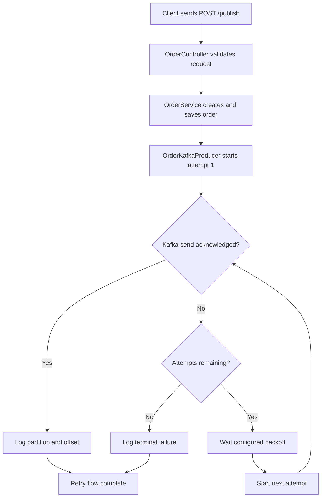
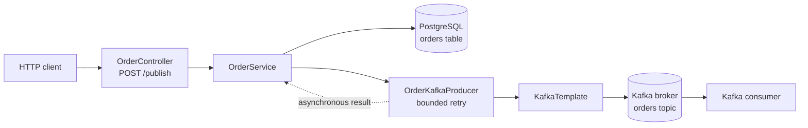
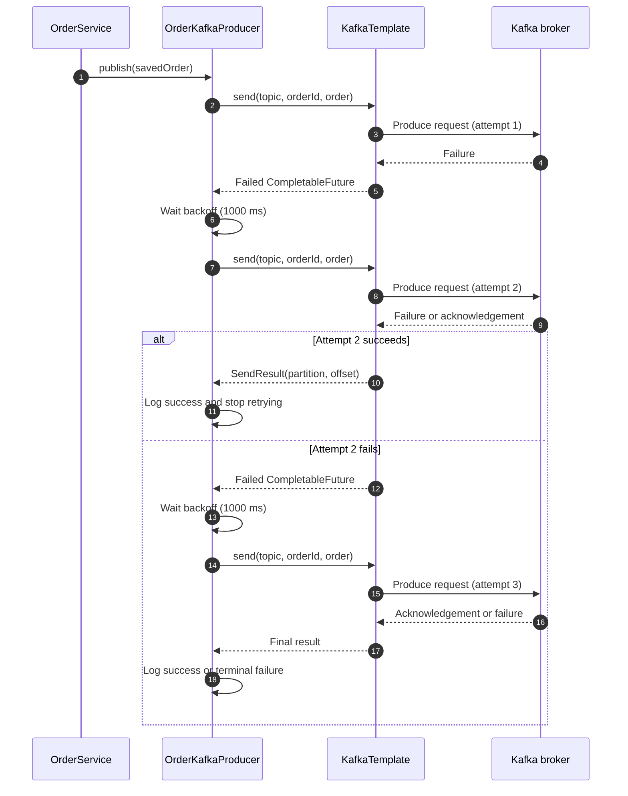

# Kafka Retry Example — Functional, Technical, and Architectural Notes

## 1. Purpose

This project demonstrates how a Spring Boot order service can retry an asynchronous Kafka producer operation. It is intentionally small so the retry lifecycle can be observed in the logs.

The flow is:

1. The client submits an order through `POST /publish`.
2. The service saves the order in PostgreSQL.
3. The producer sends the saved order as JSON to the `orders` Kafka topic.
4. If the send fails, the producer waits and retries.
5. The producer stops after the first successful send or after three total attempts.

The retry example is about producer delivery failures. It is not a replacement for Kafka consumer retry topics, dead-letter topics, or a transactional outbox.

## 2. Functional requirements

### Success behavior

- Accept a valid order request.
- Persist the order with status `CREATED`.
- Publish the persisted order to Kafka topic `orders`.
- Use the order id as the Kafka message key.
- Log the topic, partition, and offset after Kafka acknowledges the record.
- Return the normal HTTP response without waiting for the asynchronous Kafka callback.

### Retry behavior

- Attempt 1 is always the initial Kafka send.
- A failed send is retried at most two more times.
- The maximum is three total attempts, not three retries after the initial attempt.
- The default delay between attempts is one second.
- A successful attempt stops the retry chain immediately.
- A failure on the final attempt is logged as a terminal failure.

### Non-functional expectations

- Retry count and delay must be configurable without changing Java code.
- Log entries must identify the order id, attempt number, topic, and final error.
- The retry chain must not create an unbounded loop.
- The example must make the database/Kafka consistency limitation explicit.

## 3. Functional flow



## 4. Architecture

### Components

| Component | Responsibility |
|---|---|
| `OrderController` | Exposes the HTTP endpoint and maps the request to the service layer. |
| `OrderService` | Creates the order, persists it with JPA, and starts Kafka publishing. |
| `OrderRepository` | Persists orders in PostgreSQL. |
| `OrderKafkaProducer` | Sends the order asynchronously and applies the bounded retry policy. |
| `KafkaTemplate` | Spring Kafka abstraction that creates the producer send future. |
| Kafka broker | Stores the event in the `orders` topic and returns the record metadata. |
| PostgreSQL | Stores the order record independently of Kafka delivery. |

### Architectural diagram



The database and Kafka broker are separate systems. The database commit can succeed even when every Kafka attempt fails. This is expected in this educational example because the producer call is asynchronous and is not part of the PostgreSQL transaction.

## 5. Technical retry flow



## 6. Implementation details

### Configuration

Configuration is in `src/main/resources/application.properties`:

```properties
app.kafka.topic=orders
app.kafka.retry.max-attempts=3
app.kafka.retry.backoff-ms=1000
```

The constructor clamps invalid values:

- `maxAttempts < 1` becomes `1`.
- `backoffMs < 0` becomes `0`.

### CompletableFuture chaining

`KafkaTemplate.send(...)` returns a `CompletableFuture<SendResult<String, Order>>`. The producer attaches `handle(...)` so both success and failure can be processed. On failure, the code either:

- returns a failed future when the final attempt has been reached, or
- waits for the fixed backoff and recursively starts the next attempt.

`thenCompose(...)` flattens the nested future returned by the retry branch into one future representing the complete retry operation.

The code also catches an exception thrown synchronously by `kafkaTemplate.send(...)`, such as an immediate serialization/configuration failure, and converts it into a failed future so it follows the same retry path.

### Message identity

The order id is used as the Kafka key. All attempts for the same order therefore use the same key and are routed consistently by Kafka partitioning. This does not by itself provide exactly-once processing; consumers should still design for duplicate delivery.

### Producer-level retries

This example adds an application-level retry around `KafkaTemplate.send`. Kafka producer clients may also have their own internal retry settings. If both are enabled, one application attempt can contain multiple broker-level requests. Set operational limits carefully to avoid unexpectedly long delivery times.

## 7. Failure scenarios

| Scenario | Result |
|---|---|
| Kafka is available on attempt 1 | One record is published; no retry occurs. |
| Attempt 1 fails, attempt 2 succeeds | Two application attempts are logged; the second success ends the chain. |
| All three attempts fail | The producer logs terminal failure; the database row remains saved. |
| Serialization fails immediately | The exception is converted to a failed future and follows the configured retry count. |
| Thread is interrupted during backoff | Interrupt status is restored and the retry chain completes exceptionally. |
| HTTP request finishes before Kafka callback | The client can receive a success response before final Kafka delivery is known. |

## 8. Operational guidance

Monitor at least:

- terminal publish failures;
- retry count by topic and error type;
- Kafka producer request latency;
- producer buffer exhaustion and broker availability;
- orders saved in PostgreSQL without a corresponding Kafka event.

For production use, consider:

1. A transactional outbox when the database write and event publication must be reliably coordinated.
2. A dead-letter or parking topic for records that remain undeliverable.
3. Exponential backoff with jitter for outages affecting many producers.
4. A scheduled executor or framework retry scheduler instead of sleeping on a common async worker.
5. Idempotent consumers because retries can produce duplicate records if a broker acknowledgement is lost after the record is accepted.
6. Micrometer metrics and alerting for terminal failures rather than relying only on logs.

## 9. Local verification

Start PostgreSQL and Kafka, then run:

```bash
mvn spring-boot:run
```

Submit an order:

```bash
curl -X POST http://localhost:8082/publish ^
  -H "Content-Type: application/json" ^
  -d "{\"productCode\":\"P1001\",\"productName\":\"Laptop\",\"quantity\":2,\"price\":50000}"
```

Observe the application logs for `attempt 1/3`, `attempt 2/3`, or `attempt 3/3`. Consume the topic with:

```bash
kafka-console-consumer.sh --topic orders --from-beginning --bootstrap-server localhost:9092
```

To demonstrate retries, stop Kafka before submitting an order, then restart it during the configured retry window. The exact result depends on broker startup time and producer connection behavior.
